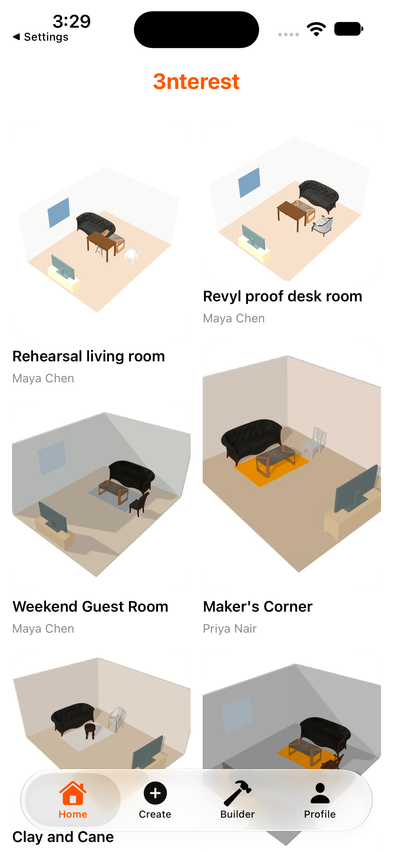
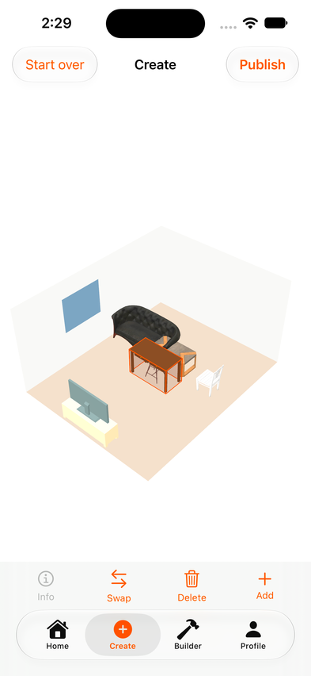
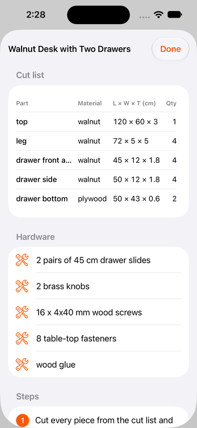
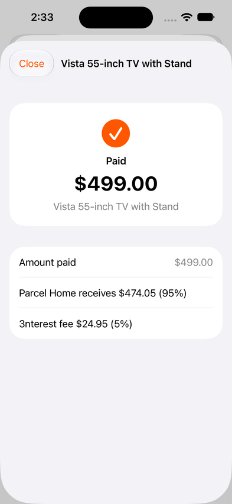

<p></p>

# 3nterest

**Pinterest, but every pin is a room you can walk into and buy from.**

3nterest is 3D + Pinterest, pronounced "interest". It was built in one day at the YC Consumer Mobile Hackathon on 2026-11-15 by three developers, each running coding agents.

<p>
  
  
  
  
</p>

## What it does

- **A feed of 3D rooms.** Home is a feed of published rooms; opening one shows it in 3D with its item list.
- **Scan a room, or use the sample.** A LiDAR scan (RoomPlan) is rebuilt out of separate, movable products matched from the catalogue by category and size, each linked to its vendor. "Use sample room" does the same without scanning.
- **Rearrange it.** Drag, swap, and add products from the catalogue, or scan a real object into the room.
- **Design a piece with AI.** Describe something in the builder chat and get a 3D design with a cut list; canned designs cover the case where the live call fails.
- **List it for sale and buy through Whop.** A design can be listed in the catalogue; products are bought through a Whop checkout.
- **Publish to the feed.**

## Anyone can get paid

Interest is a marketplace on Whop: one platform account, and one sub-account per seller.

- **Checkout.** A Convex action (`convex/payments.ts`) creates a Whop checkout configuration on the seller's sub-account, with 5% of the price set as the application fee. The seller gets 95%, the platform keeps 5%.
- **Confirmation.** The app's order is confirmed only after the backend (`convex/orders.ts`, `convex/lib/verifyPayment.ts`) finds a successful Whop payment linked to that order. One payment confirms one order. Otherwise the order stays pending and the app shows "We couldn't find your payment yet".
- **Receipt and Seller earnings** both show the 95/5 split.

Limits, stated plainly: this runs in Whop's sandbox with test cards. The confirm step fails open so the demo never dead-ends: an order is marked paid without verification if it used the fallback checkout link, if no Whop API key is configured, or if Whop does not answer within 4 seconds or answers with a 5xx. A 4xx, a 429, or an unreadable answer leaves the order pending.

## Built with

- **Convex**: the feed, file storage for models and thumbnails, and the actions that keep the OpenAI and Whop keys off the phone.
- **Capy**: each developer had a Captain directing crew threads, one per task, each opening its own pull request. The commit and pull request history shows it.
- **Revyl**: the agents' machines have no Xcode, so builds ran on Revyl's runners, and the demo script was rehearsed on a Revyl cloud iPhone.
- **Whop**: checkout and the seller split, as above.
- **OpenAI**: the builder's structured design (parts, cut list, steps), called from a Convex action.

## Architecture

A SwiftUI app with SceneKit for 3D and RoomPlan for scanning. `Interest/Shared` holds the model types and a `Backend` protocol; `ConvexBackend` talks to Convex, and a bundled `StubBackend` is the fallback.

## Run it

```bash
xcodegen generate        # then open the project, set your team and bundle id
npx convex dev
npx convex run seed:run
```

Convex environment variables (names only): `OPENAI_API_KEY`, `OPENAI_MODEL`, `WHOP_API_BASE`, `WHOP_API_KEY`, `WHOP_FALLBACK_CHECKOUT_URL`.

Live scanning needs a LiDAR iPhone; otherwise tap "Use sample room".

## Team

Bennett Oyler (app, screens, payments), Devin Cheng (3D), Vasu Ganesa (backend).
